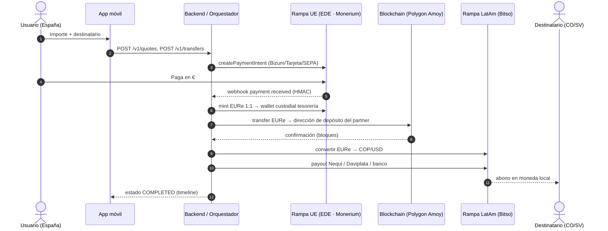
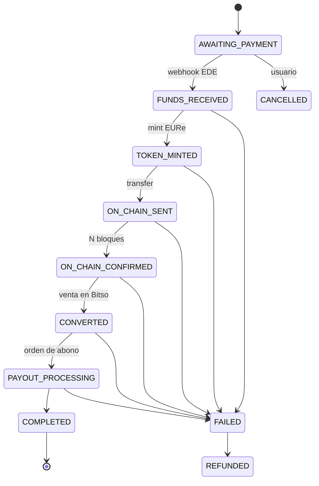

# Arquitectura técnica

## Visión

El usuario sólo ve euros y moneda local. La blockchain se usa exclusivamente
como **capa de liquidación** entre dos partners regulados, sustituyendo a la
cadena de bancos corresponsales (días y comisiones altas) por una
transferencia de token euro que se liquida en segundos por céntimos.

## Componentes

### Backend (`backend/`, Node.js + Express)

| Módulo | Responsabilidad |
|---|---|
| `src/domain/quote.js` | Cotización: comisión fija (0,99 €) + margen FX (0,50 %) sobre tipo medio. Importes siempre en unidades menores enteras. |
| `src/domain/recipients.js` | Validación de destinatarios: móvil CO (Nequi/Daviplata), cédula, bancos CO, DUI con dígito verificador, bancos SV. |
| `src/domain/identity.js` | Validación DNI/NIE (letra de control) y pasaporte del remitente. |
| `src/domain/transferStates.js` | Máquina de estados con transiciones explícitas. |
| `src/services/transferService.js` | Orquestador: límites, screening AML, idempotencia, liquidación paso a paso, reembolso ante fallo, asientos de tesorería. |
| `src/providers/*` | Adaptadores intercambiables (ver [`providers/README.md`](../backend/src/providers/README.md)). |
| `src/app.js` | API REST, auth, webhooks firmados y utilidades de sandbox. |

### Máquina de estados de un envío

### Flujo de fondos y tesorería

- Se tokeniza el **importe íntegro** en la wallet custodial de tesorería.
- On-chain sólo viaja `importe − comisión fija`; la comisión queda en tesorería (`fee_revenue`).
- El partner convierte al tipo medio; la diferencia con el tipo prometido al cliente es el margen FX (`fx_margin`). Un margen negativo genera alerta.
- Ante cualquier fallo tras el pago, el envío pasa a `FAILED → REFUNDED` (en producción, cola de revisión de operaciones).

### API REST (v1)

| Método | Ruta | Descripción |
|---|---|---|
| POST | `/v1/auth/register`, `/v1/auth/login` | Alta / sesión (token Bearer) |
| GET | `/v1/me` | Perfil, estado KYC, límites y volumen diario |
| POST | `/v1/kyc/sessions`, `/v1/kyc/sessions/:id/submit` | Verificación de identidad |
| GET | `/v1/corridors` | Corredores, métodos de cobro y bancos |
| POST | `/v1/quotes` | Cotización `{ corridorId, amount, mode: send\|receive }` |
| GET/POST/DELETE | `/v1/recipients` | Destinatarios |
| POST | `/v1/transfers` | Crear envío (`Idempotency-Key` recomendado) |
| GET | `/v1/transfers`, `/v1/transfers/:id` | Historial y estado con timeline |
| POST | `/v1/transfers/:id/cancel` | Cancelar si está pendiente de pago |
| POST | `/v1/webhooks/onramp` | Webhook del EDE (cabecera `x-signature` HMAC-SHA256) |
| POST | `/v1/sandbox/transfers/:id/simulate-payment` | Sólo sandbox: simula el pago |
| GET | `/v1/sandbox/ledger`, `/v1/sandbox/audit` | Sólo sandbox: tesorería y auditoría |

### App móvil (`mobile/`, Expo SDK 58)

Pantallas: bienvenida y registro · verificación de identidad · inicio con
tipo de cambio del día · calculadora con teclado propio y cotización en vivo ·
destinatarios · confirmación tipo recibo y elección de pago · seguimiento en
tiempo real · actividad · perfil con límites del piloto. Navegación propia
(pila + barra inferior con botón central de envío). Capturas en
[`docs/capturas`](capturas).

Sistema visual "Tinta y mango" (`mobile/src/theme.js`): azul tinta `#0B1B3F`
para confianza, mango `#FFB020` como único color de acción, tipografía
Bricolage Grotesque para cifras y títulos e Inter para texto, iconos Feather y
banderas dibujadas (sin emojis, idénticas en iOS, Android y web).

## Decisiones y alternativas

| Decisión | Motivo | Alternativas a evaluar |
|---|---|---|
| Token **EURe (Monerium)** | Dinero electrónico emitido por EDE autorizada en la UE; rampa SEPA nativa | EURC (Circle) — posiblemente mayor liquidez en exchanges LatAm |
| Red **Polygon (Amoy en testnet)** | EVM, comisiones de céntimos, soporte de EURe | Stellar (diseñada para remesas), Solana |
| **Wallets custodiales** de tesorería | El usuario no gestiona claves; control AML centralizado | MPC (p. ej. Fireblocks, Circle) en Fase 2 |
| Monolito modular Node.js | Velocidad de prototipado; adaptadores aislados | Separar orquestador en workers con cola (BullMQ / SQS) |
| Almacén en memoria | Prototipo sin infraestructura | PostgreSQL + migraciones en Fase 2 |

## Riesgos técnicos identificados

1. **Liquidez del par token euro → COP** en el partner LatAm. Puede requerir
   pasar por USDC (EURe→USDC→COP), con un segundo spread. Validar con Bitso.
2. **Volatilidad FX entre cotización y conversión** (120 s). Mitigación:
   cotización corta, alerta de margen negativo, coberturas en Fase 2.
3. **Gestión de claves** de la wallet de tesorería: HSM/MPC obligatorio antes de producción.
4. **Pre-financiación**: para entregas en segundos reales, mantener saldo de COP/USD en el partner y reponer de forma asíncrona.

## Hoja de ruta técnica

1. **Claves sandbox**: Monerium Sandbox (OAuth, IBAN de prueba, mint EURe en testnet) y Bitso Sandbox (conversión + retiros simulados).
2. **Adaptador `chain` real** para Polygon Amoy (ERC-20 con `ethers`/`viem`, gas de faucet).
3. **Adaptadores `onRamp`/`offRamp` reales** cumpliendo los contratos de `providers/README.md`; activar con `PROVIDER_MODE=sandbox`.
4. **Persistencia** PostgreSQL, cola de trabajos para la liquidación y reintentos idempotentes por etapa.
5. **Seguridad**: rate limiting, refresh tokens, cifrado de datos personales en reposo, registro de auditoría inmutable.
6. **App**: almacenamiento seguro de sesión (`expo-secure-store`), SDK KYC real, notificaciones push de estado.
