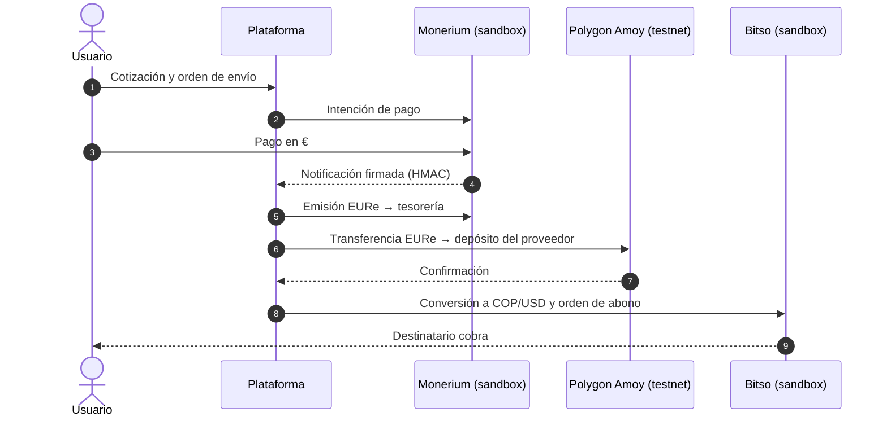

# Memoria Justificativa — Solicitud de acceso al Espacio Controlado de Pruebas

**Proyecto:** Remesas LatAm — liquidación de remesas España ➔ Latinoamérica mediante tokens de dinero electrónico en euros sobre tecnología de registro distribuido (DLT)

**Marco:** Ley 7/2020, de 13 de noviembre, para la transformación digital del sistema financiero

**Promotor:** [COMPLETAR: nombre / razón social, NIF, domicilio, persona de contacto]

**Versión:** borrador técnico v0.1 · [COMPLETAR: fecha]

> **Cómo usar este borrador.** Contiene la parte técnica y los resultados
> del prototipo. Los apartados marcados **[COMPLETAR]** requieren datos del
> promotor, de los partners o de fuentes oficiales. Los marcados
> **[VERIFICAR]** son afirmaciones sobre terceros (licencias, cobertura) que
> hay que confirmar documentalmente antes de presentar. Antes de presentar,
> conviene que lo revise un asesor especializado en servicios de pago, MiCA y
> prevención del blanqueo.

---

## 1. Resumen ejecutivo

Remesas LatAm es una solución de envío de dinero desde España hacia
Colombia (corredor principal) y El Salvador (corredor secundario). El
usuario paga en euros con medios habituales (Bizum, tarjeta, transferencia
SEPA) y el destinatario recibe moneda local (COP o USD) en su billetera
móvil (Nequi, Daviplata) o en su cuenta bancaria.

La innovación está en la **capa de liquidación**: en lugar de la cadena de
bancos corresponsales, los fondos se liquidan entre dos entidades reguladas
mediante un **token de dinero electrónico en euros** (EURe, emitido 1:1 por
una entidad de dinero electrónico autorizada en el EEE) que se transfiere
por una red DLT pública de bajo coste en segundos.

Para el usuario la experiencia es 100 % fiat: no maneja criptoactivos,
claves ni billeteras.

**Qué se solicita probar:** la viabilidad técnica, operativa y de
cumplimiento de este modelo de liquidación con usuarios reales, con
importes limitados y bajo supervisión, antes de pedir la autorización
definitiva o de operar como agente de una entidad autorizada.

**Resultados del prototipo:** ver el [informe del plan de pruebas](evidencias/plan-pruebas-informe.md).
100 operaciones de extremo a extremo, 100 % con el resultado esperado,
trazabilidad completa y conciliación exacta de la tesorería (entorno
simulado).

## 2. Requisitos de acceso (Ley 7/2020) y cómo los cumple el proyecto

La Ley exige que el proyecto aporte una **innovación de base tecnológica
aplicable en el sistema financiero**, que esté **suficientemente avanzado
para probarse** y que aporte **utilidad o valor añadido** en alguno de los
ámbitos que la propia Ley enumera. [VERIFICAR la redacción vigente de los
artículos aplicables y citar los apartados exactos.]

| Requisito / ámbito de valor añadido | Cómo lo cumple el proyecto | Evidencia |
|---|---|---|
| Innovación de base tecnológica | Liquidación transfronteriza con tokens de dinero electrónico en euros (EMT según MiCA) sobre DLT pública, orquestada por API | §4, §5 |
| Proyecto suficientemente avanzado | Prototipo funcional: backend, app móvil, 21 pruebas automáticas y plan de 100 operaciones | §6, `docs/evidencias/` |
| Beneficio para el usuario: reducción de costes | Coste total medio del 1,72 % en el plan de pruebas, frente a la referencia de mercado [COMPLETAR con dato oficial] | §3.2, informe |
| Beneficio para el usuario: calidad y acceso | Entrega en minutos (no días), abono directo en billeteras móviles de uso mayoritario en destino | §4 |
| Mayor protección del usuario | Precio total y tipo de cambio mostrados antes de pagar y bloqueados durante 120 s; reembolso automático si falla el abono | §7.3 |
| Eficiencia de entidades y mercados | Sustituye la cadena de corresponsalía por una liquidación entre dos entidades; conciliación automática | §5.4 |
| Mejora de la gestión de riesgos y del cumplimiento | Trazabilidad inmutable de cada liquidación (hash verificable); controles AML automatizados; registro de auditoría | §7 |

## 3. Problema y beneficio social

### 3.1 Contexto

- Población de origen colombiano y salvadoreño residente en España: [COMPLETAR: dato del INE, padrón continuo].
- Volumen de remesas enviadas desde España a Colombia y El Salvador: [COMPLETAR: Banco de España, balanza de pagos; Banco de la República de Colombia; Banco Central de Reserva de El Salvador].
- Peso de las remesas en los hogares receptores: [COMPLETAR].

### 3.2 Coste actual frente a la solución propuesta

El coste medio de una remesa España ➔ Colombia y España ➔ El Salvador debe
citarse de la base oficial *Remittance Prices Worldwide* del Banco Mundial,
desglosado por tipo de proveedor (banco, operador de transferencias):
[COMPLETAR: coste medio para un envío de 200 € y fecha del dato].

Resultados del plan de pruebas (entorno simulado, 75 envíos completados de
entre 10 y 300 €):

| Indicador | Valor |
|---|---|
| Coste total medio para el usuario (comisión + margen de cambio) | 1,72 % |
| Coste en un envío de 200 € | 0,99 % |
| Coste mínimo / máximo | 0,83 % / 10,30 % (envío mínimo de 10 €) |
| Ahorro estimado frente a una referencia del 6 % | 568,47 € sobre 11.677 € enviados |

> **Nota sobre precios.** La comisión fija de 0,99 € hace que el coste
> porcentual sea alto en envíos muy pequeños. Antes de presentar, conviene
> decidir el modelo de precio definitivo (p. ej. comisión fija menor,
> comisión porcentual con mínimo, o importe mínimo de 50 €) para poder
> afirmar un coste máximo concreto. Además, los tipos de cambio del
> prototipo son de referencia: el margen real del proveedor de liquidez en
> destino se medirá en el sandbox.

El ODS 10.c de Naciones Unidas fija el objetivo de que el coste de las
remesas baje del 3 % para 2030. Esta solución se sitúa por debajo de ese
umbral en los envíos de importe habitual.

### 3.3 Inclusión financiera

- El remitente sólo necesita un medio de pago habitual en España (Bizum o tarjeta).
- El destinatario cobra en billeteras móviles (Nequi, Daviplata) a las que se accede con el número de móvil y el documento de identidad, sin necesidad de ir a una sucursal.

## 4. Descripción del modelo de negocio y del flujo de fondos

```
[Usuario en España]
   │ 1. Paga en € (Bizum / tarjeta / SEPA) a la entidad de dinero electrónico (EDE) partner
   ▼
[EDE partner · rampa de entrada UE]
   │ 2. Emite EURe 1:1 en la wallet de tesorería de la plataforma
   ▼
[Red DLT pública · Polygon]
   │ 3. Transferencia del token al proveedor de liquidez en destino (segundos)
   ▼
[Proveedor de liquidez LatAm · rampa de salida]
   │ 4. Convierte a COP / USD y ordena el abono
   ▼
[Destinatario] ➔ Nequi / Daviplata / cuenta bancaria
```

| Actor | Función | Estado regulatorio |
|---|---|---|
| Promotor (plataforma) | Interfaz de usuario, orquestación, cumplimiento de primer nivel | Sin licencia propia; objeto de las pruebas |
| Rampa de entrada UE: Monerium (alternativa: Bit2Me) | Recepción de euros, verificación de identidad (KYC) y emisión del token | Monerium: EDE autorizada en el EEE [VERIFICAR autoridad y número de registro]. Bit2Me: proveedor de servicios de criptoactivos autorizado por la CNMV bajo MiCA [VERIFICAR] |
| Red DLT | Liquidación y registro inmutable | Infraestructura pública; no custodia fondos |
| Rampa de salida LatAm: Bitso (alternativa: Buda.com) | Conversión y abono en moneda local | [VERIFICAR licencias y cobertura en Colombia y El Salvador, y si admite abono en Nequi/Daviplata] |

**Ingresos:** comisión fija por envío (0,99 € en el prototipo) y margen
sobre el tipo de cambio (0,50 %).

**Fondos de clientes:** los euros los recibe y custodia la EDE partner. La
plataforma no recibe euros de clientes en cuentas propias.

## 5. Arquitectura técnica

Detalle completo en [arquitectura.md](arquitectura.md). Resumen:

### 5.1 Componentes

- **App móvil** (React Native / Expo, iOS y Android): registro, verificación de identidad, calculadora, destinatarios, pago y seguimiento en tiempo real.
- **Backend** (Node.js): API REST, orquestador de liquidación con máquina de estados, motor de límites, screening de sanciones, conciliación y registro de auditoría.
- **Adaptadores de proveedores**: cada proveedor (verificación de identidad, rampa UE, DLT, rampa LatAm) se conecta a través de una interfaz común. Pasar de simulado a sandbox y después a producción sólo cambia el adaptador.

### 5.2 Diagrama de integración



### 5.3 Estados de una operación

`AWAITING_PAYMENT → FUNDS_RECEIVED → TOKEN_MINTED → ON_CHAIN_SENT →
ON_CHAIN_CONFIRMED → CONVERTED → PAYOUT_PROCESSING → COMPLETED`, con
salidas controladas a `CANCELLED` (antes del pago) y `FAILED → REFUNDED`.
Cada cambio de estado queda en el historial de la operación y en el
registro de auditoría.

### 5.4 Trazabilidad y conciliación

- Cada operación guarda el hash de la emisión y el de la transferencia, verificables en un explorador público.
- La wallet de tesorería debe contener exactamente las comisiones cobradas; el plan de pruebas lo comprueba de forma automática.
- Asientos de tesorería por operación: pago del cliente, comisión, margen de cambio, abono y, si aplica, reembolso.

### 5.5 Seguridad

- Contraseñas con scrypt; sesiones firmadas; notificaciones de partners verificadas con firma HMAC.
- Idempotencia en la creación de envíos y en las notificaciones de pago (sin doble emisión ante reenvíos; comprobado en el plan de pruebas).
- Pendiente para el sandbox: custodia de claves de tesorería con HSM o MPC, cifrado de datos personales en reposo, limitación de peticiones, pruebas de penetración [COMPLETAR plan y fechas].

## 6. Grado de madurez y prototipo

| Elemento | Estado | Evidencia |
|---|---|---|
| App móvil funcional | ✅ | [Vídeo de la demo](evidencias/demo-app.mp4), [capturas](capturas) |
| Backend y orquestador | ✅ | Código fuente, 21 pruebas automáticas |
| Plan de 100 operaciones | ✅ (simulado) | [Informe](evidencias/plan-pruebas-informe.md), [detalle JSON](evidencias/plan-pruebas-resultados.json) |
| Conexión con el sandbox de Monerium | 🟡 Script listo, pendiente de credenciales | `npm run verificar-sandbox` ➔ `evidencias/verificacion-sandbox.json` |
| Conexión con el sandbox de Bitso | 🟡 Script listo, pendiente de credenciales | Ídem |
| Liquidación en Polygon Amoy (testnet) | 🟡 Pendiente | Ídem (comprobación de RPC) |

> **Antes de presentar:** el vídeo y el plan de pruebas actuales usan un
> entorno simulado. Hay que conectar al menos el sandbox de la rampa de
> entrada y la testnet, repetir el plan de pruebas y volver a grabar el
> vídeo, para poder decir que las órdenes se ejecutan en testnet.

## 7. Cumplimiento normativo y gestión de riesgos

### 7.1 Normativa afectada [VERIFICAR con asesor]

- Servicios de pago (envío de dinero): Real Decreto-ley 19/2018 (transposición de la PSD2). Es la actividad reservada que se prueba en el sandbox.
- Prevención del blanqueo de capitales: Ley 10/2010 y su reglamento.
- Criptoactivos: Reglamento (UE) 2023/1114 (MiCA), en particular el régimen de los tokens de dinero electrónico.
- Información que debe acompañar a las transferencias de criptoactivos: Reglamento (UE) 2023/1113 ("travel rule").
- Protección de datos: RGPD y LOPDGDD; transferencias internacionales de datos a Colombia y El Salvador.

### 7.2 Verificación de identidad y prevención del blanqueo

- **Identidad:** verificación obligatoria antes del primer envío, con DNI, NIE o pasaporte y prueba de vida, a través del SDK del partner regulado. El prototipo ya valida la letra de control de DNI/NIE y bloquea los envíos de usuarios no verificados.
- **Destinatarios:** validación del documento (cédula colombiana, DUI salvadoreño con dígito de control) y del medio de cobro; comprobación contra listas de sanciones en cada envío.
- **Seguimiento:** registro de auditoría de altas, verificaciones, operaciones y coincidencias en listas. Pendiente para el sandbox: reglas de detección de operaciones sospechosas y procedimiento de comunicación al SEPBLAC, junto con el partner [COMPLETAR].

### 7.3 Límites propuestos para el periodo de pruebas

| Parámetro | Valor |
|---|---|
| Importe por operación | 10 € – 300 € |
| Volumen por usuario | 600 € / 24 h · 1.500 € / 30 días |
| Número de participantes | [COMPLETAR, p. ej. 100–200 usuarios] |
| Duración | [COMPLETAR, p. ej. 6 meses] |
| Corredores | España ➔ Colombia; España ➔ El Salvador |

Los límites ya están implementados en el prototipo y se comprueban con
pruebas automáticas.

### 7.4 Protección de los participantes

La Ley exige, entre otras cosas, el consentimiento informado de los
participantes, un régimen de responsabilidad del promotor por los daños
que causen las pruebas y garantías suficientes para cubrirlos. [VERIFICAR
artículos y requisitos concretos.] El proyecto prevé:

- Documento de consentimiento informado con los riesgos, los límites y el derecho a abandonar las pruebas en cualquier momento [COMPLETAR borrador].
- Garantía para cubrir la responsabilidad: [COMPLETAR: seguro de responsabilidad civil, aval o fondo, con su importe].
- Reembolso automático e íntegro si un abono no se completa (comprobado en el plan de pruebas: 10 de 10 casos).
- Canal de atención y reclamaciones [COMPLETAR].

### 7.5 Matriz de riesgos

| Riesgo | Impacto | Mitigación |
|---|---|---|
| Fallo del abono en destino | Medio | Reembolso automático; estado `REFUNDED` trazable |
| Variación del tipo de cambio entre cotización y conversión | Medio | Cotización válida 120 s; alerta de margen negativo; colchón de liquidez |
| Notificaciones de pago duplicadas o fraudulentas | Alto | Firma HMAC e idempotencia; sin doble emisión |
| Compromiso de las claves de tesorería | Alto | HSM/MPC, saldo mínimo operativo, rotación de claves |
| Liquidez insuficiente del par EURe ➔ COP | Medio | Ruta alternativa por USDC; prefinanciación en destino |
| Caída de un proveedor | Medio | Adaptadores intercambiables; proveedor alternativo identificado |
| Blanqueo / financiación del terrorismo | Alto | Verificación de identidad, screening, límites bajos, auditoría |

## 8. Plan de pruebas en el sandbox

### 8.1 Objetivos y métricas

| Objetivo | Métrica | Umbral de éxito |
|---|---|---|
| Estabilidad de la cadena € ➔ EURe ➔ COP/USD | % de operaciones con el resultado esperado | ≥ 99 % |
| Velocidad | Tiempo desde la confirmación del pago hasta el abono (media / p95) | [COMPLETAR, p. ej. < 2 min / < 10 min] |
| Coste para el usuario | Coste total medio (comisión + margen de cambio) | [COMPLETAR, p. ej. ≤ 1,5 %] |
| Trazabilidad | % de operaciones completadas con hash verificable y conciliadas | 100 % |
| Protección | % de incidencias resueltas con reembolso íntegro | 100 % |
| Cumplimiento | Coincidencias en listas detectadas y bloqueadas | 100 % |

### 8.2 Fases

1. **Fase técnica (sin usuarios):** repetir el plan de 100 operaciones con los sandbox reales de Monerium y Bitso y la testnet Polygon Amoy. Herramienta: `npm run plan-pruebas`.
2. **Fase piloto (usuarios reales, importes limitados):** [COMPLETAR número de usuarios, duración y criterios de selección].
3. **Informe final** al supervisor con las métricas de §8.1.

### 8.3 Escenarios incluidos en el plan automatizado

| Escenario | Proporción | Resultado esperado |
|---|---|---|
| Envío estándar (5 medios de cobro, 3 medios de pago, 10–300 €) | 70 % | Entregado |
| Abono rechazado en destino | 10 % | Reembolso íntegro |
| Destinatario en lista de sanciones | 5 % | Bloqueado para revisión |
| Importe superior al límite | 5 % | Rechazado |
| Notificación de pago duplicada | 5 % | Entregado una sola vez, sin doble emisión |
| Cancelación antes del pago | 5 % | Cancelado |

## 9. Plan de salida

- **Si el resultado es positivo:** operar como agente de una entidad de pago o de dinero electrónico autorizada, o solicitar autorización propia ante el Banco de España [COMPLETAR opción preferida].
- **Si es negativo o se interrumpen las pruebas:** cierre ordenado, reembolso de cualquier operación pendiente, conservación de registros y comunicación a los participantes.

## 10. Equipo y medios

[COMPLETAR: equipo, experiencia en pagos, tecnología y cumplimiento; asesores; financiación disponible para el periodo de pruebas.]

## Anexos

- A. [Arquitectura técnica](arquitectura.md)
- B. [Informe del plan de pruebas](evidencias/plan-pruebas-informe.md) y [resultados](evidencias/plan-pruebas-resultados.json)
- C. [Vídeo de la demo](evidencias/demo-app.mp4) y [capturas](capturas)
- D. Verificación de los sandbox: `evidencias/verificacion-sandbox.json` (se genera con `npm run verificar-sandbox`)
- E. [COMPLETAR] Cartas de intención de los partners
- F. [COMPLETAR] Borrador del consentimiento informado
